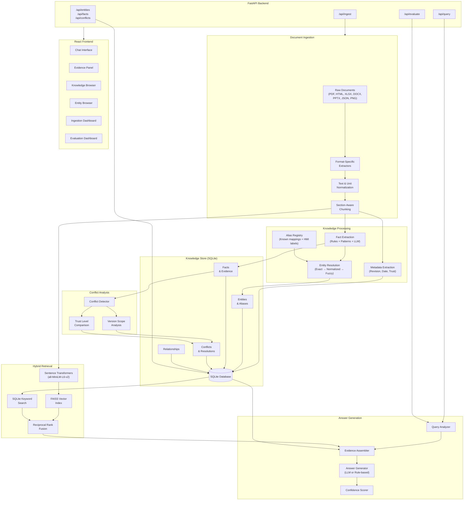

# Aegis Knowledge System — Architecture

## Overview

The Aegis Knowledge System is an evidence-based AI knowledge ingestion and question-answering system designed for the Aegis Series-7 Hydraulic Control System. It ingests heterogeneous technical documentation, extracts structured facts with full provenance, resolves component aliases, manages conflicting and version-scoped information, and answers questions using only verifiable evidence.

## Architecture Diagram



## Component Responsibilities

### Document Ingestion Layer
- **Extractor Registry**: Routes files to format-specific extractors based on file extension
- **Format Extractors**: 8 extractors (PDF, Scanned PDF/OCR, HTML, DOCX, XLSX, PPTX, JSON, PNG) each implementing a common `ExtractorProtocol`
- **Text Normalizer**: Standardizes whitespace, encoding, and control characters
- **Unit Normalizer**: Standardizes unit representations (PSI, °C, GPM, etc.)
- **Text Chunker**: Section-aware chunking with configurable overlap

### Knowledge Processing Layer
- **Fact Extractor**: Three-tier extraction: regex patterns → table parsing → LLM (when available)
- **Metadata Extractor**: Extracts revision numbers, dates, document IDs, and determines trust levels
- **Entity Resolver**: Four-tier resolution: exact match → deterministic normalization → alias registry → fuzzy matching
- **Alias Registry**: Maintains known component name/ID/HMI label mappings

### Knowledge Store
- **SQLite with SQLAlchemy**: Persistent storage for Documents, Entities, Facts, Evidence, Conflicts, Relationships
- **Full Provenance**: Every fact traces back to its source document, page, section, and source text
- **Conflict Detection**: Automatic detection of value mismatches, version differences, and source disagreements

### Retrieval Layer
- **Semantic Search**: Sentence Transformers embeddings indexed in FAISS
- **Keyword Search**: SQLite-based text matching on entities, facts, and chunks
- **Hybrid Retriever**: Reciprocal Rank Fusion combining semantic and keyword results

### Reasoning Layer
- **Query Analyzer**: Identifies entities, predicates, and question type from natural language
- **Evidence Assembler**: Gathers and ranks relevant facts by trust level and recency
- **Answer Generator**: LLM-grounded (when available) or rule-based answer construction
- **Confidence Scorer**: Multi-factor scoring based on evidence count, source trust, and agreement

## Data Flow

1. **Ingestion**: Raw documents → format extraction → normalization → chunking → fact extraction → entity resolution → conflict detection → persistent storage
2. **Indexing**: Document chunks → embedding → FAISS index (for semantic search)
3. **Querying**: Question → entity identification → hybrid retrieval → evidence assembly → conflict analysis → answer generation with citations
4. **Evaluation**: Predefined questions → query pipeline → metric calculation → report generation

## Knowledge Representation

### Provenance Model
Every answerable fact in the system traces back through:
```
Fact → Evidence → Document (with page, section, source text)
```

### Conflict Resolution
The system never silently resolves conflicts. Instead:
1. Facts are grouped by `(subject_entity, predicate)`
2. Differing values create `Conflict` records
3. Resolution is attempted via revision scope and trust levels
4. Unresolvable conflicts are preserved and surfaced to users

### Deterministic vs Model-Based Processing
| Stage | Deterministic | Model-Based |
|-------|--------------|-------------|
| Text extraction | All formats | OCR (Tesseract) |
| Fact extraction | Patterns, tables, JSON | Unstructured prose |
| Entity resolution | Exact, normalized, alias registry | Fuzzy matching |
| Answer generation | Structured fact lookup | Natural language synthesis |
| Conflict detection | All | None |
